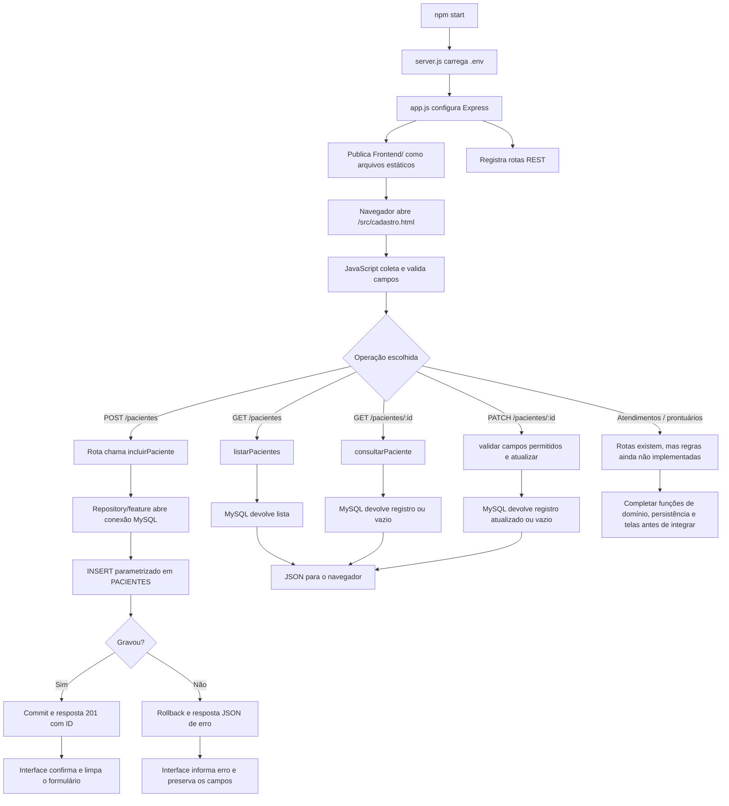

# Fluxo de execução do projeto

## Inicialização

O processo único é iniciado por `npm start`, que executa `Backend/scripts_integracao/server.js`. O Express carrega as variáveis de ambiente, disponibiliza os arquivos de `Frontend/` e registra as rotas da API. O cadastro deve ser aberto por HTTP em `/src/cadastro.html`; abrir o arquivo HTML diretamente pelo sistema de arquivos não faz parte do fluxo integrado.

## Contrato atual de pacientes

| Método e caminho | Resultado esperado |
| --- | --- |
| `POST /pacientes` | `201` com `{ id, mensagem }` após inclusão |
| `GET /pacientes` | `200` com uma lista de pacientes |
| `GET /pacientes/:id` | `200` com um paciente; `404` quando não existe |
| `PATCH /pacientes/:id` | `200` com o paciente atualizado; `404` quando não existe |

O backend usa os nomes de colunas atuais da tabela `PACIENTES` e `id` como identificador. A confirmação do esquema real do MySQL ainda é necessária. Os campos de e-mail e tipo de atendimento apresentados pela tela não têm colunas/entidade correspondentes no SQL atual; a seleção do tipo não é persistida como um atendimento. Alergias, dados do responsável e contato de emergência também não existem no formulário atual, portanto são enviados como `null` nesta tela.

## Situação de atendimento e prontuário

As rotas REST de atendimentos e prontuários estão declaradas, mas as funções de consulta, inclusão, edição, listagem e histórico estão vazias ou lançam erro de “não implementada”. O painel de triagem ainda usa linhas estáticas e `sessionStorage`, sem carregar pacientes/atendimentos da API. Essas partes aparecem como pendência no fluxo Mermaid: não devem ser consideradas integrações funcionais ainda.

## Limites da verificação

O diagrama descreve o código e os ajustes feitos. A conexão, os nomes reais das colunas e constraints do MySQL dependem do banco local e precisam ser conferidos nesse ambiente. As funções de atendimento/prontuário não são cobertas como fluxos concluídos.
